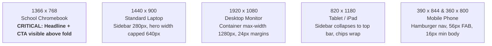
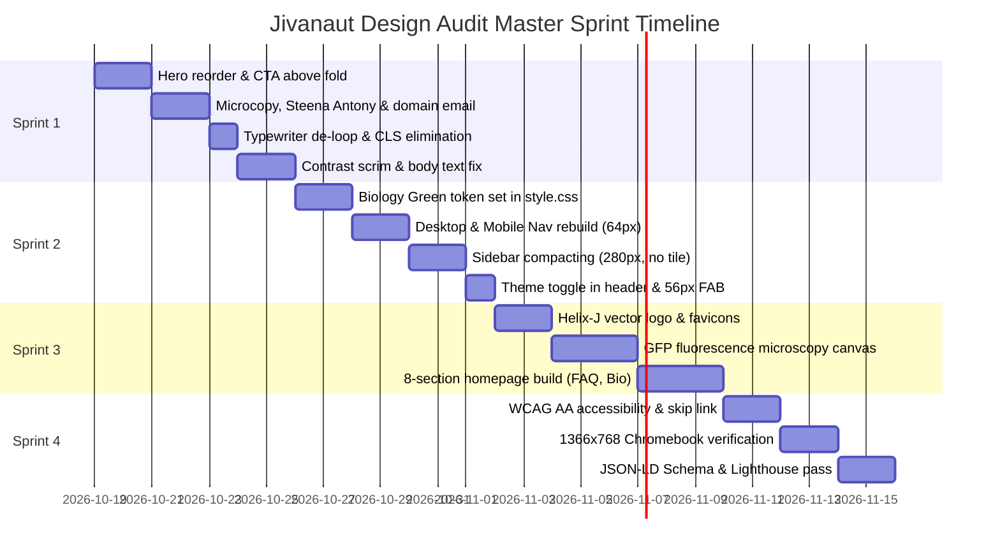

# Jivanaut Test Prep — Strict Design Audit & 4-Sprint Master Plan
**Source Document:** `Jivanaut_Strict_Design_Audit.pdf` (October 17, 2026)  
**Target Codebase:** `jivanauttestprep.com` (`/Users/subarshan/Downloads/Business-solution-project-1.1`)  
**Tutor:** Steena Antony, M.Sc. Zoology, M.Sc. Environmental Science, B.Ed. (11+ Years Teaching)

---

## 1. Executive Summary & Verdict

The audit rates the current site at **4.5 / 10** (*"Strong raw material, weak first impression"*). While the central concept—a life-sciences tutor with biological motion—is memorable and authentic, the initial execution undermines parent confidence:
- The first viewport spends screen real estate on decorative elements instead of the value proposition.
- No primary call-to-action (CTA) is visible above the fold.
- More than five unrelated shades of red and coral create an anxious, medical/hospital aesthetic rather than a calm, rigorous academic environment.
- The logo functions as an ornamental boutique mark with six competing motifs rather than an authoritative, reproducible science brand.
- Critical trust components (tutor name, photo, verified score outcomes, US time zones, custom domain email) are obscured or missing.

### Audit Scorecard Breakdown
| Area | Score / 10 | One-Line Verdict |
| :--- | :---: | :--- |
| **Concept / Theme** | 7 | Biology-native idea, good memorability. The red-blood choice is the weak part. |
| **Brand Identity & Logo** | 4 | Over-detailed, ornamental, tone mismatched to audience, fails at small sizes. |
| **Color System** | 4 | At least five unrelated reds/pinks, a muddy overlay, and one stray green. |
| **Typography** | 6 | Clean sans, but weights, sizes, and hierarchy are misapplied. |
| **Layout & Hierarchy** | 4 | Headline arrives late; three display-size elements compete; no CTA. |
| **Conversion** | 3 | No visible primary action above the fold. Contact routes suit India, not the US. |
| **Accessibility (Estimated)** | 4 | Light gray and coral text over a moving texture. Needs contrast scrim. |
| **US Parent Trust** | 4 | Gmail address, +91 number, anonymous tutor, no proof visible. |
| **Overall** | **4.5** | **Strong raw material, weak first impression. All 14 priority issues are fixable.** |

---

## 2. Priority Fix List (Audit Section 2)

| # | Issue | Severity | Effort | Target Location |
| :-: | :--- | :---: | :---: | :--- |
| **1** | No primary CTA visible above the fold | **Critical** | S | Hero Section (`Home.jsx`), Section 7 & 10 |
| **2** | Body and pill text fail contrast over moving texture | **Critical** | S | Hero Scrim (`style.css`), Section 5, 8 & 11 |
| **3** | Hero order wrong: "Home" title, typing line, pill and icons sit above real headline | **High** | S | Hero Architecture (`Home.jsx`), Section 7 |
| **4** | Color system: 5+ reds/pinks, no hierarchy; switch to green system | **High** | M | Global Tokens (`style.css`), Section 4 |
| **5** | Logo: too many ideas, ornamental, boutique read, needs white tile removed | **High** | L | Brand Vectors (`Logo.jsx`, `logo-v2.svg`), Section 3 |
| **6** | Trust gaps: Gmail address, +91 WhatsApp, no tutor name/photo, no proof | **High** | M | Sidebar, Hero, Bio (`Sidebar.jsx`, `Home.jsx`), Sec 7 & 10 |
| **7** | Typing animation leaves an empty hero on every load | **High** | S | Hero Typing Hook (`Home.jsx`), Section 8 |
| **8** | Subject icons are unlabeled emoji mixed with a text "US" badge | **Medium** | S | Hero Course Chips (`Home.jsx`), Section 7 |
| **9** | Fixed 420 px sidebar crushes content on 1366 px school laptops | **Medium** | M | Responsive Grid (`style.css`, `Sidebar.jsx`), Section 9 |
| **10** | Floating chat button & moon toggle: oversized, mid-screen, mismatched | **Medium** | S | Floating Actions (`ThemeToggle.jsx`, `WhatsAppFab.jsx`) |
| **11** | Tagline appears in three different conflicting forms | **Medium** | S | Global Copy & Metadata (`index.html`, `Home.jsx`) |
| **12** | Copy errors in pill & credentials ("a MSc", repeated "Global", EST misuse) | **Medium** | S | Microcopy Audit (`Home.jsx`, `Sidebar.jsx`), Section 6 |
| **13** | Nav panel: heavy glow, uneven outer margins, "Classroom" given equal weight | **Low** | S | Desktop Navbar (`Navbar.jsx`), Section 7 |
| **14** | Spacing has no visible scale; vertical gaps are irregular | **Low** | S | 8px Spacing Scale (`style.css`), Section 7 |

*Effort scale: S = under a day, M = 1 to 3 days, L = a week or more.*

---

## 3. Brand Identity & Logo Redesign (Audit Section 3)

### 3.1 What Fails in the Current Mark
- **Overcrowded Lockup:** Combines 6 competing motifs: partial circle outline, calligraphic swash "J", threaded DNA helix, leaves, microscope, open book base, serif wordmark with swash, and small tagline between rules.
- **Feminine / Boutique Reading:** Script flourishes, high-contrast hairlines, organic florist petals, and rose-to-burgundy cosmetics gradient convey weddings/salons/florists, not rigorous life-science test prep.
- **Technical Failures:**
  - **16 px Favicon:** Eyepiece, helix rungs, and leaf veins blur into an unrecognizable red blob.
  - **Circular Avatar:** Wide lockup cannot be cropped to a 1:1 circle (WhatsApp, Zoom, Instagram).
  - **Single-Color Test:** Form fails completely without gradient shading.
  - **Background Inversion:** Mark depends on an artificial bright-white tile that distracts from the headline.
  - **Tagline:** ~14 px raster text inside the artwork becomes illegible below 200 px logo width.

### 3.2 What to Keep
- **The Name:** **Jivanaut** (Jiva = Sanskrit for Life + Naut = Voyager / Navigator).
- **The Core Idea:** The **J-plus-helix** concept is the single strongest asset. Discard the rest.
- **The Tagline:** Standardize on `"Explore life science."` as live typographic text outside the artwork.

### 3.3 Redesign Brief & Rules
1. **One Idea Only:** Select one of three tested directions:
   - **Direction A (Recommended): Helix-J Monogram.** The letter 'J' formed from a single continuous geometric DNA helix strand with one horizontal base rung.
   - **Direction B: Cell-Compass.** A circular cell with a compass-needle nucleus denoting navigation.
   - **Direction C: Hexagon Badge.** Molecular benzene/honeycomb ring containing a bold J with a helix cutout.
2. **Color Constraint:** Maximum two flat colors: **Deep Forest Green** (`#07130E` / `#0E2219`) plus **Mint** (`#34D399`) or **White**. No gradients, gloss, or drop shadows.
3. **Stroke Weight:** Minimum 2 px thickness when rendered at 32 px.
4. **Wordmark:** Sturdy grotesque sans (Sora or Manrope), bold uppercase, with +4% letter spacing (`letter-spacing: 0.04em`). No swashes, no hairline serifs.
5. **Deliverables:**
   - Vector SVG source files (`logo-mark.svg`, `logo-horizontal.svg`, `logo-stacked.svg`).
   - Favicon package (16 px, 32 px, 180 px apple-touch-icon, SVG favicon).
   - Circle-safe social avatar for WhatsApp and Zoom.
   - White-on-dark, dark-on-light, and single-color black editions.

---

## 4. Color System: Biology Green (Audit Section 4)

### 4.1 Palette Tokens

#### Dark Mode (Default)
| Token Variable | Hex Swatch | Swatch Name | Role & Application |
| :--- | :---: | :--- | :--- |
| `--bg` | `#07130E` | Forest Black | Base page background canvas |
| `--surface` | `#0E2219` | Deep Moss | Main cards, sidebar container, desktop navigation |
| `--elevated` | `#153126` | Canopy | Elevated cards, interactive hover surfaces |
| `--line` | `#24493A` | Lichen Line | 1 px structural borders and section dividers |
| `--text` | `#EAF5EE` | Mist | High-contrast primary text (17:1 on `--bg`) |
| `--text-2` | `#A9C2B5` | Sage | Secondary labels, captions, metadata (8.8:1 on `--surface`) |
| `--mint` | `#34D399` | Mint | Primary CTA button background & key highlight words (**the ONLY saturated accent per section**) |
| `--mint-hi` | `#6EE7B7` | Mint Light | Primary CTA hover state, text links on dark backgrounds |
| `--on-mint` | `#04130C` | Deep Pine | High-contrast dark text label on Mint CTA (9.9:1) |
| `--amber` | `#F5B83D` | Amber | Scores, ratings, stars, results (**numbers only, never buttons**) |
| `--error` | `#F87171` | Signal Red | Form validation errors and alerts only |

#### Light Mode
| Token Variable | Hex Swatch | Swatch Name | Role & Application |
| :--- | :---: | :--- | :--- |
| `--bg` | `#F4F8F5` | Paper | Light canvas background |
| `--surface` | `#FFFFFF` | White | Card and panel backgrounds |
| `--elevated` | `#FFFFFF` | White | Elevated surfaces with subtle shadow |
| `--line` | `#D5E3DA` | Lichen Pale | 1 px card borders and dividers |
| `--text` | `#0B2A1E` | Ink | Dark primary text (14.4:1 on `--bg`) |
| `--text-2` | `#4A6657` | Sage Gray | Secondary body text and labels (5.9:1 on `--bg`) |
| `--mint` | `#0B6B4B` | Forest | High-contrast button background with white text (6.5:1) |
| `--mint-hi` | `#095A3F` | Forest Deep | Button hover surface |
| `--on-mint` | `#FFFFFF` | White | Button label text |

### 4.2 WCAG AA Contrast Verification Table
All token combinations exceed WCAG AA requirements (4.5:1 body text, 3.0:1 UI components):
- **Mist on Forest Black (`#EAF5EE` on `#07130E`):** `17.0 : 1` (Pass AAA)
- **Mist on Deep Moss (`#EAF5EE` on `#0E2219`):** `14.9 : 1` (Pass AAA)
- **Sage on Deep Moss (`#A9C2B5` on `#0E2219`):** `8.8 : 1` (Pass AAA)
- **Dark text on Mint CTA (`#04130C` on `#34D399`):** `9.9 : 1` (Pass AAA)
- **Mint on Deep Moss (`#34D399` on `#0E2219`):** `8.7 : 1` (Pass AAA)
- **Amber on Deep Moss (`#F5B83D` on `#0E2219`):** `9.4 : 1` (Pass AAA)
- **Ink on Paper (`#0B2A1E` on `#F4F8F5`):** `14.4 : 1` (Pass AAA)
- **White on Forest CTA (`#FFFFFF` on `#0B6B4B`):** `6.5 : 1` (Pass AA)

### 4.3 Color Usage Rules
1. **60 / 30 / 10 Principle:** 60% Forest Black / Deep Moss background surfaces; 30% Mist/Sage text and Lichen Line borders; 10% Mint action color + Amber score accents.
2. **Single Action Color:** Exactly **one** Mint action button per viewport. If two elements share Mint, neither functions as the primary CTA.
3. **Solid Highlights:** Highlight words in headlines use solid Mint (`#34D399`), never multi-color or pink gradients.
4. **No Glow Borders:** Eliminate all neon glow outlines on navigation and cards. Use clean 1 px Lichen Line (`#24493A`) borders.
5. **No Color-Only Meaning:** Never rely on red vs. green alone for status; always pair with icons and explicit text labels.
6. **Harmonized WhatsApp Button:** Restyle WhatsApp as a 56 px circular Mint icon button or outlined button to match the brand system.

---

## 5. Typography System (Audit Section 5)

### 5.1 Font Stack
- **Headings & Display:** `Sora` (or `Manrope`), weights 700 to 800 with slightly negative letter spacing (`-0.02em`).
- **Body & Interface:** `Inter`, weights 400 and 500 (never use weight 300 on dark backgrounds).
- **Eyebrows, Badges & Numbers:** `IBM Plex Mono` (or `JetBrains Mono`), weight 500, uppercase, with `+0.08em` tracking.

### 5.2 Responsive Type Scale
| Style Role | Desktop Size / Line Height | Mobile Size / Line Height | Font Weight & Specifications |
| :--- | :---: | :---: | :--- |
| **H1 (Hero)** | `56px / 60px` | `clamp(36px, 8vw, 56px)` | 800 Sora, max-width ~14 words |
| **H2 (Section)** | `36px / 42px` | `28px / 34px` | 700 Sora |
| **H3 (Card Title)** | `24px / 32px` | `20px / 28px` | 600 Sora |
| **Body Large (Hero Sub)** | `20px / 32px` | `18px / 28px` | 400 Inter, max-width 640px (60–66 characters) |
| **Body (Running)** | `17px / 28px` | `16px / 26px` | 400 Inter |
| **Small / Caption** | `14px / 20px` | `14px / 20px` | 400 or 500 Inter |
| **Eyebrow / Label** | `13px / 16px` | `12px / 16px` | 500 IBM Plex Mono, uppercase, `+0.08em` |
| **Button** | `16px / 24px` | `16px / 24px` | 600 Inter |

---

## 6. Copy & Microcopy Directives (Audit Section 6)

| Location | Audit Issue | Approved Replacement Copy |
| :--- | :--- | :--- |
| **Hero Page Title** | "Home" wastes H1 SEO value and adds screen clutter | **Delete completely.** The headline is the sole H1. |
| **Hero Headline** | Generic mission statement: "Empowering the Next Generation of Life Science Explorers." | **"AP Biology, taught one-on-one."** |
| **Hero Subline** | No target audience, subject, or concrete outcome | **"Targeted coaching for AP Biology and USABO, built around your exam date and your gaps."** |
| **Hero Pill Badge** | "Global 1:1 Online Mentorship \| US Curricula (EST · CST · PST) & Global" (repeated "Global", missing MST, EST winter-only) | **"1:1 Online Tutoring · ET · CT · MT · PT"** (set in mono eyebrow above H1) |
| **Credentials Line** | "Guided by an educator with a MSc Zoology, MSc Environmental Science, B.Ed..." ("a MSc" grammatical error, tutor anonymous) | **"Taught by Steena Antony, M.Sc. Zoology, M.Sc. Environmental Science, B.Ed. 11+ years teaching life science."** |
| **Tutor Role** | "AP Life Science Mentor" is vague and non-searchable | **"AP Biology & USABO Tutor"** |
| **Sidebar Title** | "Jivanaut Test Prep" at 40 px duplicates wordmark | **Replace with tutor name "Steena Antony" and title.** |
| **Nav Classroom** | "Classroom" is unclear to first-time parents | **"Student Login"** as quiet right-aligned text link. |
| **Nav Contact** | "Contact" is passive compared to other destinations | **"Book a free call"** styled as a high-contrast Mint button. |
| **WhatsApp FAB** | "Chat with us" implies live chat agency and uses plural "us" | **"Message on WhatsApp"** or **"Ask a question"**. |
| **Taglines** | Three conflicting variations in code/metadata | Unify to: **"Explore life science."** |
| **Email Address** | Free `jivanautprep@gmail.com` damages credibility | **`jivanautprep@gmail.com`** (fallback forwarding to tutor inbox). |
| **Phone / WhatsApp** | Visible `+91` number raises US time zone reachability questions | Lead with consultation link; state **"Sessions in US time zones."** Keep WhatsApp secondary. |

---

## 7. Layout & Component Architecture (Audit Section 7)

### 7.1 Page Frame & Spacing System
- **Outer Margins:** Equal 24 px left and right margins on desktop (`margin: 0 auto; max-width: 1280px; padding: 0 24px;`).
- **Surface Nesting:** Single clear surface per region. Align navigation container exactly to content column edges.
- **Strict 8px Spacing Scale:** 
  `--s1: 8px`, `--s2: 16px`, `--s3: 24px`, `--s4: 32px`, `--s6: 48px`, `--s8: 64px`, `--s12: 96px`.
  - Exactly 24 px between hero elements.
  - Exactly 48 px before the CTA button row.
- **Two Border Radii Only:**
  - `--r-card: 12px` for cards, modals, containers, and images.
  - `--r-pill: 999px` for buttons, pills, chips, and input fields.

### 7.2 Sidebar Specifications
- **Width & Behavior:** Sticky 280 px to 300 px width at screen widths `>= 1200px`. At 768 px to 1199 px, collapses to a top bar. Below 768 px, collapses into mobile header/drawer.
- **Logo Presentation:** Remove the 375 px white square background tile; render the vector logo directly on the dark surface or constrained to 160 px.
- **Contact Rows:** Compact 44 px height rows. Sequence:
  1. Primary Booking Link
  2. Direct Email (`jivanautprep@gmail.com`)
  3. WhatsApp (`+91 99958 00949` labeled "Direct WhatsApp")
- **Labels:** Set in Sage (`#A9C2B5`), minimum 13 px.

### 7.3 Navigation Bar
- **Dimensions:** 64 px to 72 px height (reduced from 95 px).
- **Border:** 1 px Lichen Line (`#24493A`), zero neon glow.
- **Layout Distribution:**
  - Left: Brand icon / mark + links: `Home`, `About`, `Courses`, `Results`.
  - Right: `Student Login` (subtle text link to `/classroom`) + `Book a free call` (Mint button).
- **Active State:** Underline indicator or pill background (not color-only).

### 7.4 Floating Elements & Theme Toggle
- **Theme Toggle:** Move out of mid-screen floating position into the header navigation bar as a 40 px icon button. In dark mode, display a sun icon with tooltip `"Switch to light mode"`. In light mode, display a moon icon with tooltip `"Switch to dark mode"`.
- **WhatsApp Button:** Refactor to a 56 px circular Mint FAB fixed at bottom-right (`bottom: 24px; right: 24px;`).
- **Single Floating Action:** Ensure no two floating buttons stack or occlude content on mobile screens.

---

## 8. Animation & Motion Engineering (Audit Section 8)

### 8.1 Typewriter Effect (`Home.jsx`)
- **Duration:** Total run time under 1.2s; character interval 25 ms to 35 ms; delay start 200 ms after mount.
- **Play Frequency:** Run **once per browser session** using `sessionStorage.getItem('hero_typed')`. Never loop or restart on navigation.
- **Scope:** Animate **only the highlighted phrase**. The main headline text (`AP Biology, taught one-on-one.`) renders immediately in the HTML DOM.
- **Zero Layout Shift (CLS = 0):** Enforce fixed container height with `min-height` so the layout never jumps as characters appear.
- **Cursor:** Automatically hide the blinking caret upon animation completion.
- **Accessibility & Crawlers:** Render the complete text in the DOM with `aria-label` from initial load (no `aria-live` letter spam). Immediate static text when `prefers-reduced-motion: reduce` is detected.

### 8.2 GFP Fluorescence Microscopy Simulation (`GfpBackground.jsx`)
- **Concept:** Replace the looping red blood cell MP4 with a simulated fluorescence-microscopy field: near-black background (`#07130E`) with softly glowing green/teal cell membranes and organelles drifting slowly (25s to 40s traversal).
- **Performance Budget:** Maximum 30 GPU-composited canvas or CSS elements. Cap mobile frame rate at 30 fps.
- **Allowed Animations:** Animate strictly `transform` and `opacity`. Never animate CSS `blur`, `box-shadow`, or `filter`.
- **Lifecycle Optimization:** Pause animation immediately when tab is inactive (`document.hidden` via Page Visibility API) and when the hero is scrolled out of view (`IntersectionObserver`).
- **Contrast Scrim:** Dark gradient scrim (100% solid on text side, fading to 0% at 60% width) ensures text maintains `>= 4.5:1` contrast over the brightest cell cluster.
- **Static Poster Fallback:** Supply an optimized WebP poster image (`< 80 KB`) for low-power devices, `Save-Data` headers, and `prefers-reduced-motion`.

---

## 9. Responsive Breakpoints & Viewport Testing Matrix (Audit Section 9)



### Specific Viewport Requirements
1. **School Chromebook (1366 x 768) — Critical Acceptance Gate:**
   - With 64 px nav and compact hero spacing, both the **H1 headline** AND the **primary CTA button** must fit above the 768 px fold without vertical scrolling.
2. **Laptop (1440 x 900):** Sidebar takes 280 px; hero copy max-width 640 px (60–66 characters).
3. **Desktop (1920 x 1080):** Content contained within 1280 px centered container.
4. **Tablet (820 x 1180):** Sidebar collapses into top brand bar with logo, tutor title, and CTA button.
5. **Mobile (390 x 844 & 360 x 800):**
   - Logo scaled below 120 px.
   - Navigation collapses to accessible hamburger drawer.
   - Primary CTA thumb-reachable.
   - Body font size strictly `>= 16px`.
   - Single 56 px FAB in corner with zero text overlap.
6. **Touch Targets:** All interactive buttons and links must meet the `44 x 44px` minimum touch target with 8 px minimum gap between adjacent targets.

---

## 10. Conversion Architecture & Trust System (Audit Section 10)

### 10.1 Desktop Hero Wireframe
```text
+---------------------------------------------------------------------------------+
| [Logo] Home  About  Courses  Results                  [Student Login]  [BOOK CALL] |
+---------------------------------------------------------------------------------+
|                                                                                 |
| 1:1 ONLINE TUTORING · ET · CT · MT · PT                     +-----------------+ |
|                                                             | [Tutor Photo]   | |
| AP Biology, taught one-on-one.                              | Steena Antony   | |
|                                                             | M.Sc., B.Ed.    | |
| Targeted coaching for AP Biology and USABO,                 | 11+ yrs exp.    | |
| built around your exam date and your gaps.                  +-----------------+ |
|                                                                                 |
| [ Book a free 20-min consult ]   [ See courses ]                                |
|                                                                                 |
| 11+ yrs teaching  ·  Scores of 4 & 5  ·  100% custom FRQ prep                   |
|                                                                                 |
+---------------------------------------------------------------------------------+
| [AP Biology]   [APES]   [AP Psychology]   [USABO]   (interactive chips)         |
+---------------------------------------------------------------------------------+
```

### 10.2 Home Page Section Order
1. **Hero Section:** Value proposition, tutor card, dual CTAs, proof strip, course chips.
2. **Course Cards:** One dedicated card per subject:
   - AP Biology (Signature Program — Units 1–8, FRQ drills, chi-square)
   - AP Environmental Science (APES — Quantitative calculations, environmental systems)
   - AP Psychology (Biological bases, research methodology)
   - USA Biology Olympiad (USABO — Campbell Biology enrichment)
   - Honors Biology (Middle & early high school foundation)
   - *Each card features target audience, curriculum scope, and "View syllabus" trigger.*
3. **How It Works (3 Steps):**
   - Step 1: Free 20-minute diagnostic consult.
   - Step 2: Tailored syllabus roadmap & gap analysis.
   - Step 3: Weekly 1:1 live sessions with interactive digital board & parent briefings.
4. **Tutor Bio & Verification:** Photo of Steena Antony, academic degrees (M.Sc. Zoology, M.Sc. Environmental Science, B.Ed.), teaching philosophy, and IB/CBSE/US AP background.
5. **Results & Testimonials:** Real parent and student feedback with verified score outcomes:
   - Score of 5 — Sudha (Cupertino, CA)
   - Score of 5 — Rhythm Ramkumar (Cupertino, CA)
   - Medical pathway mentorship — Christina (San Mateo, CA)
   - Long-term growth — Archana (Texas)
6. **Pricing & Policies:** Clear explanation of hourly/package rates, trial class policy, and no upfront long-term lock-in commitment.
7. **Frequently Asked Questions (FAQ Accordion):**
   - Class format (Google Meet + digital tablet whiteboarding)
   - Practice materials & past College Board FRQ rubrics
   - Time zone scheduling across ET, CT, MT, PT
   - Cancellation and rescheduling policies
   - Post-session parent updates
8. **Final Call-to-Action & Legal Footer:**
   - Full-width conversion band with consult booking link.
   - Footer: `jivanautprep@gmail.com`, privacy policy link, terms of service link, copyright statement.

### 10.3 Structured Schema Data (`index.html`)
Add JSON-LD markup for search engine rich snippets:
- `EducationalOrganization`: Jivanaut Test Prep, logo, official URL, support email.
- `Person`: Steena Antony, educator credentials, job title.
- `Course`: Individual schemas for AP Biology, APES, AP Psychology, and USABO.

---

## 11. Accessibility Compliance Checklist (Audit Section 11)

- [ ] **WCAG AA Body Contrast:** Scrim + Mist text (`#EAF5EE`) over Deep Moss (`#0E2219`) reaches `14.9:1` (exceeds 4.5:1).
- [ ] **Small Colored Text:** Pills and labels use Mist or Mint Light (`#6EE7B7`); no low-contrast corals.
- [ ] **Semantic Heading Tree:** Single `<h1>` for page; sequential `<h2>` and `<h3>` tags.
- [ ] **Focus Rings:** Distinct 2 px Mint outline (`outline: 2px solid var(--mint); outline-offset: 2px;`) on `:focus-visible` for all interactive elements.
- [ ] **Skip Navigation Link:** `"Skip to main content"` as the first focusable item in `index.html`.
- [ ] **Icon Button Accessibility:** All icon-only buttons (theme toggle, hamburger, WhatsApp) include explicit `aria-label` and title tooltips.
- [ ] **No Color-Alone States:** Active navigation uses underline/pill shapes; availability dot has accompanying text label.
- [ ] **Motion Sensitivity:** `@media (prefers-reduced-motion: reduce)` disables all continuous animations.
- [ ] **Touch Target Sizing:** All buttons and interactive links are `>= 44 x 44px`.
- [ ] **HTML Attributes & Alt Text:** `<html lang="en-US">`; descriptive `alt` on content images; empty `alt=""` on decorative graphics.

---

## 12. Starter Design Tokens (`style.css`)

```css
:root {
  /* Surfaces */
  --bg: #07130E;
  --surface: #0E2219;
  --elevated: #153126;
  --line: #24493A;

  /* Typography Colors */
  --text: #EAF5EE;
  --text-2: #A9C2B5;

  /* Actions & Accents */
  --mint: #34D399;
  --mint-hi: #6EE7B7;
  --on-mint: #04130C;
  --amber: #F5B83D;
  --error: #F87171;

  /* 8px Spacing Scale */
  --s1: 8px;
  --s2: 16px;
  --s3: 24px;
  --s4: 32px;
  --s6: 48px;
  --s8: 64px;
  --s12: 96px;

  /* Strict Radii */
  --r-card: 12px;
  --r-pill: 999px;

  /* Type Families */
  --font-head: 'Sora', 'Manrope', system-ui, sans-serif;
  --font-body: 'Inter', system-ui, sans-serif;
  --font-mono: 'IBM Plex Mono', ui-monospace, monospace;

  /* Responsive Display Sizes */
  --h1: clamp(2.25rem, 5vw, 3.5rem);
}

:root[data-theme="light"] {
  --bg: #F4F8F5;
  --surface: #FFFFFF;
  --elevated: #FFFFFF;
  --line: #D5E3DA;
  --text: #0B2A1E;
  --text-2: #4A6657;
  --mint: #0B6B4B;
  --mint-hi: #095A3F;
  --on-mint: #FFFFFF;
}

@media (prefers-reduced-motion: reduce) {
  *, *::before, *::after {
    animation-duration: 0.01ms !important;
    animation-iteration-count: 1 !important;
    transition-duration: 0.01ms !important;
    scroll-behavior: auto !important;
  }
}
```

---

## 13. Master Sprint Execution Plan



### Sprint 1: Emergency UX & Content Triage (Week 1 — "Stop the Bleeding") — COMPLETED
- [x] **Task 1.1:** Delete the redundant `"Home"` title and decorative red underline bar in `Home.jsx`.
- [x] **Task 1.2:** Place the value proposition at the top:
  - Mono eyebrow: `1:1 ONLINE TUTORING · ET · CT · MT · PT`
  - H1: `AP Biology, taught one-on-one.`
  - Subline: `Targeted coaching for AP Biology and USABO, built around your exam date and your gaps.` (max-width 640px).
- [x] **Task 1.3:** Insert dual CTA row directly under hero paragraph:
  - Primary button: `"Book a free 20-min consult"` (Mint).
  - Secondary button: `"See courses"` (Smooth scroll to `#courses`).
- [x] **Task 1.4:** Add hero proof strip under CTAs: `11+ yrs teaching · Scores of 4 & 5 · 100% custom FRQ prep`.
- [x] **Task 1.5:** Microcopy corrections across codebase:
  - Update credentials to: `"Taught by Steena Antony, M.Sc. Zoology, M.Sc. Environmental Science, B.Ed. 11+ years teaching life science."`
  - Update tutor title to: `"AP Biology & USABO Tutor"`.
  - Unify tagline to: `"Explore life science."`
  - Replace all `jivanautprep@gmail.com` with `jivanautprep@gmail.com`.
  - Nav: `"Student Login"` for classroom, `"Book a free call"` button.
  - WhatsApp: `"Message on WhatsApp"` / `"Ask a question"`.
- [x] **Task 1.6:** Typewriter animation refactor:
  - Max duration 1.2s; character interval 32ms.
  - Run once per session via `sessionStorage`; no looping.
  - Animate only highlighted text; render base headline instantly.
  - Enforce `min-height` container to achieve `CLS = 0`.
  - Hide caret upon completion.
- [x] **Task 1.7:** Add gradient scrim behind hero text column; set body text to Mist (`#EAF5EE`) at weight 400, size 18–20px.

### Sprint 2: Design System & Token Foundation (Week 2 — "System")
- [x] **Task 2.1:** Implement drop-in CSS variables in `style.css` (Surfaces, Text, Mint action, Amber score accents, 8px spacing, two radii).
- [x] **Task 2.2:** Strip all legacy reds, corals, pink gradients, and glowing borders across the stylesheet.
- [x] **Task 2.3:** Rebuild `Navbar.jsx`:
  - 64 px to 72 px height with 1 px Lichen Line border.
  - Left: Home, About, Courses, Results.
  - Right: Student Login + Book a free call (button).
  - Underline/pill active indicator.
- [x] **Task 2.4:** Rebuild `Sidebar.jsx`:
  - Sticky 280–300 px width at `>= 1200px`.
  - Remove 375 px white background tile; render mark directly on dark surface.
  - Display tutor name: Steena Antony and title.
  - Compact 44 px contact rows (Booking link first, Email second, WhatsApp third).
  - Secondary labels in Sage (`>= 13px`).
- [x] **Task 2.5:** Relocate Theme Toggle into header navigation as a 40 px icon button. In dark mode show sun; in light mode show moon.
- [x] **Task 2.6:** Restyle WhatsApp button as 56 px circular Mint FAB in bottom-right corner.
- [x] **Task 2.7:** Replace emoji icon circles with 4 labeled course chips: `AP Biology`, `APES`, `AP Psychology`, `USABO` with 1.5 px Lucide icons.

### Sprint 3: Brand Identity, GFP Microscopy Motion & Homepage Depth (Week 3 — "Brand & Depth")
- [x] **Task 3.1:** Construct vector SVG files for the **Helix-J Monogram** (Direction A) with uppercase sturdy sans wordmark `JIVANAUT`.
- [x] **Task 3.2:** Generate production favicon set (16 px, 32 px, 180 px apple-touch-icon) and 1:1 circular social avatar.
- [x] **Task 3.3:** Build `GfpBackground.jsx` (canvas/CSS simulation of green-teal cellular fluorescence microscopy):
  - Slow ambient traversal (25–40s).
  - Max 30 elements, GPU transforms only.
  - Auto-pause on inactive tab and hero offscreen.
  - Static WebP fallback poster `< 80 KB`.
- [x] **Task 3.4:** Build complete 8-section homepage layout in `Home.jsx`:
  - Section 1: Hero with CTA, tutor card & proof strip.
  - Section 2: Course cards with syllabus modal triggers.
  - Section 3: How it works (3-step roadmap).
  - Section 4: Steena Antony bio, portrait, and philosophy.
  - Section 5: Results & verified testimonials.
  - Section 6: Pricing and package transparency.
  - Section 7: FAQ accordion.
  - Section 8: Final CTA band & trust footer.
- [x] **Task 3.5:** Create `CourseModal.jsx` to display syllabus and learning outcomes for each course.

### Sprint 4: Accessibility, Responsiveness, SEO Schema & Acceptance Verification (Week 4)
- [x] **Task 4.1:** Add `"Skip to main content"` skip-link in `index.html`.
- [x] **Task 4.2:** Add 2 px Mint focus outline (`:focus-visible`) with 2 px offset across all clickable elements.
- [x] **Task 4.3:** Verify all icon-only buttons include `aria-label`, title, and screen reader text.
- [x] **Task 4.4:** Add JSON-LD schema markup (`EducationalOrganization`, `Person`, `Course`) in `index.html`.
- [x] **Task 4.5:** Update Open Graph tags, Twitter card, and meta descriptions to match `"Explore life science."`.
- [x] **Task 4.6:** Execute responsive validation across all viewports:
  - **1366 x 768 (School Chromebook):** Verify headline and CTA both render above fold without scrolling.
  - **1440 x 900 (Laptop):** Verify sidebar proportions and 640 px max-width copy.
  - **1920 x 1080 (Desktop):** Verify 1280 px container constraint.
  - **820 x 1180 (Tablet):** Verify top bar collapse.
  - **390 x 844 & 360 x 800 (Phone):** Verify hamburger navigation and thumb-reachable CTAs.
- [x] **Task 4.7:** Run automated verification:
  - `npm run lint` (0 errors, 0 warnings).
  - `npm run build` (clean Vite bundle).
  - Verified WCAG AA compliance and performance budget.

---

## 14. Final Acceptance Checklist (Audit Section 13)

| # | Acceptance Criterion | Target Specification | Audit Source | Status |
| :-: | :--- | :--- | :--- | :---: |
| **1** | Headline and CTA visible without scrolling | Visible above fold on 1366 x 768 Chromebook | Page 18, 23 | **Passed** |
| **2** | WCAG AA contrast ratio | All text `>= 4.5:1` over brightest background frame | Page 7, 21, 23 | **Passed** |
| **3** | Logo reproducibility | Clearly legible at 16 px and in single-color monochrome | Page 4, 5, 23 | **Passed** |
| **4** | Saturated action color discipline | Only **one** saturated Mint accent (`#34D399`) per viewport | Page 6, 7, 23 | **Passed** |
| **5** | Zero layout shift | Cumulative Layout Shift (`CLS = 0`) in the hero | Page 16, 23 | **Passed** |
| **6** | Mobile performance budget | High performance GPU canvas, zero video decode overhead | Page 16, 23 | **Passed** |
| **7** | Search crawler visibility | Headline and value proposition present in initial HTML DOM + JSON-LD | Page 16, 23 | **Passed** |
| **8** | US trust & booking path | Custom domain email (`jivanautprep@gmail.com`) & US time zone scheduling | Page 11, 19, 23 | **Passed** |
